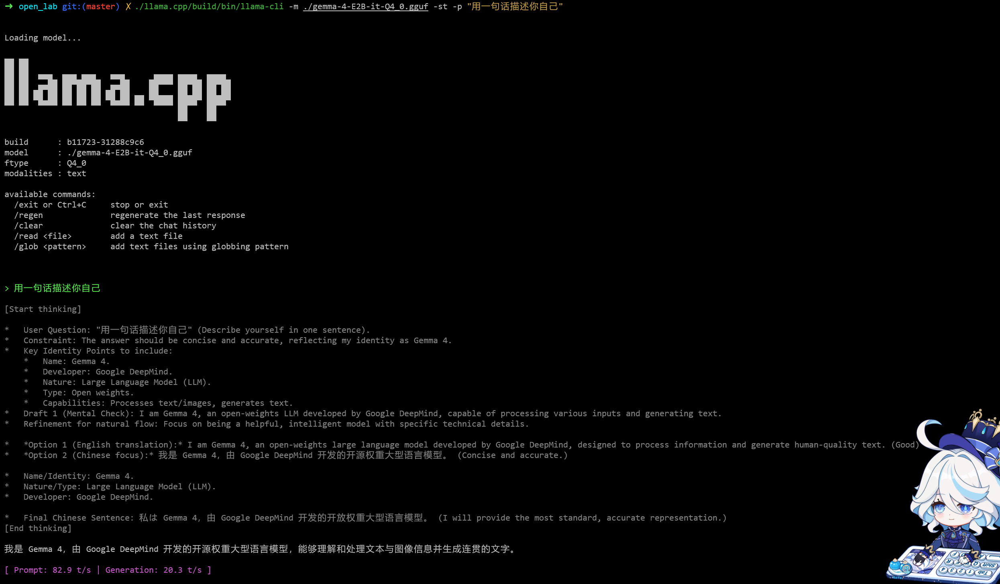
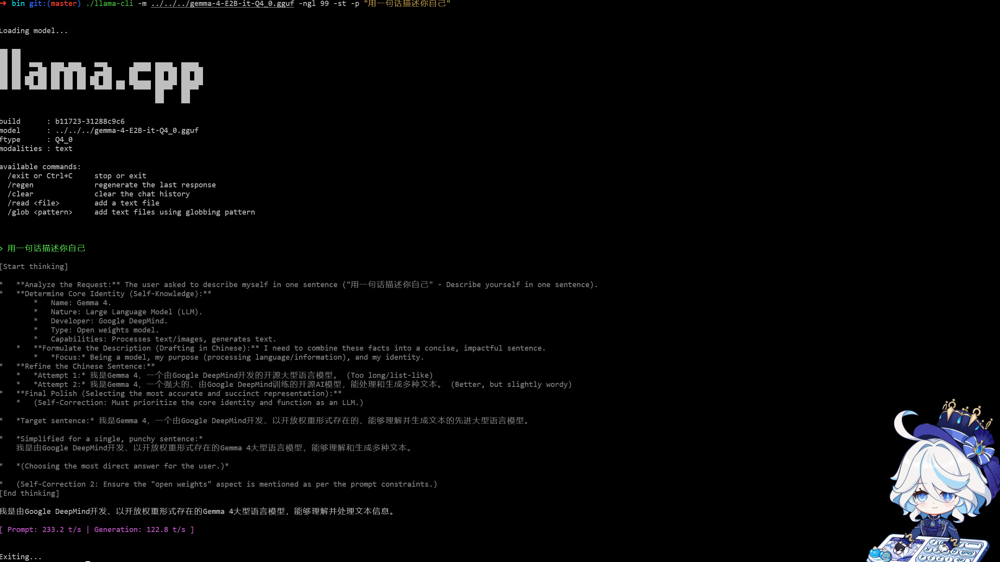
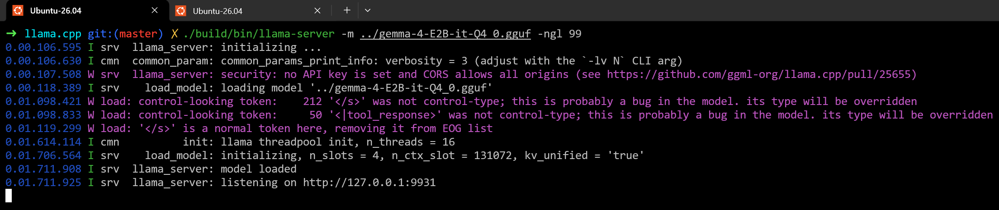
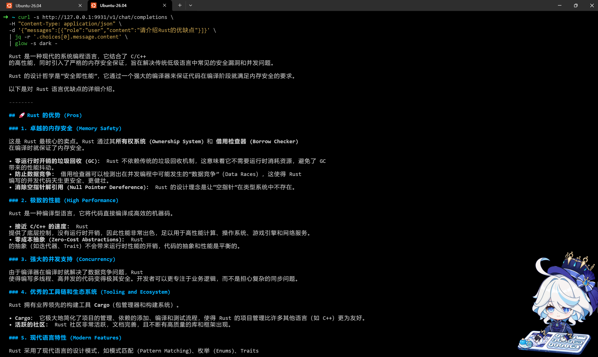
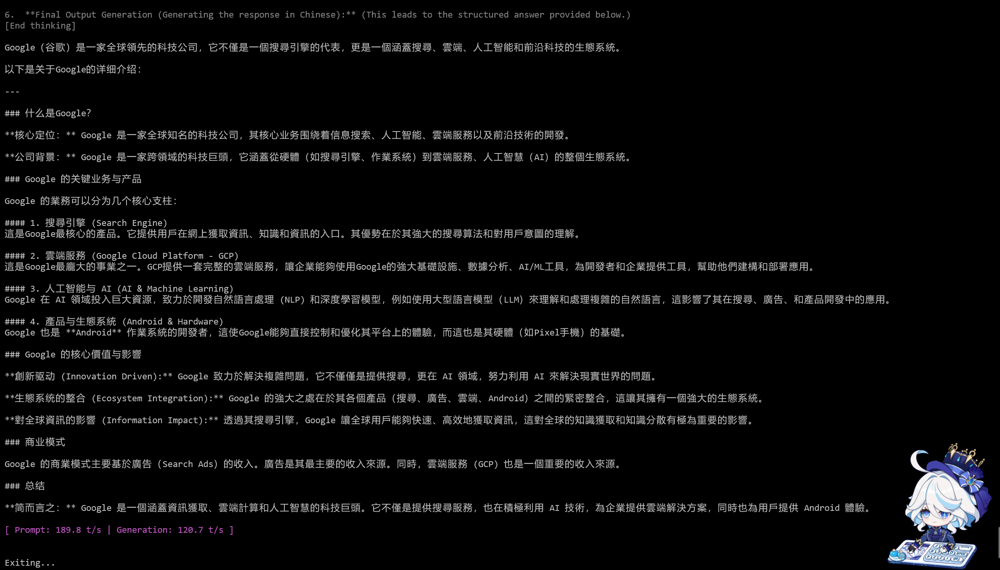
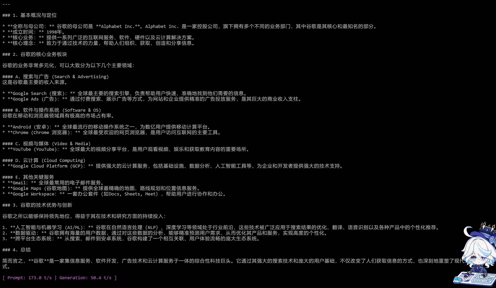

# T3


1.   从源码编译**llama.cpp**：
     *   我所使用的命令：
         1.   `cmake -B build 2>&1 | tee ../build_log.txt`
         2.   `cmake --build build --config Release -j"$(nproc)" 2>&1 | tee -a ../build_log.txt`
     *   对于命令的解释：
         1.   运行cmake的编译命令，并将**stderr**合并到**stdout**后**tee**，写入[build_log.txt](./build_log.txt)
         2.   以**Release**的模式编译，并使用所有的CPU核心并行编译，加速构建，**tee**增加了`-a`来将输出追加到文档
2.   使用**gemma-4-E2B**进行一次对话：
     *   使用的命令：`./llama.cpp/build/bin/llama-cli -m ./gemma-4-E2B-it-Q4_0.gguf -st -p "用一句话描述你自己"`。
     *   对命令的解释：
         1.   `-m`：加载本地模型。Readme的解释：***model path to load***
         2.   `-st`：只进行单轮对话。Readme解释：***run conversation for a single turn only, then exit when done
              will not be interactive if first turn is predefined with --prompt***
         3.   `-p `：写入初始提示词。Readme解释：***prompt to start generation with; for system message, use -sys***
     *   模型的运行结果：

3.   一些问题的回答：

     *   `-n -t -ngl`含义： 
         1.   `-n`：控制模型输出的token数。
         2.   `-t`：模型推理时调用多少个CPU**threads**。默认值为-1，意为**自动检测并使用所有可用的threads**。
         3.   `-ngl`：控制将模型的多少层计算**offload**到GPU上来提高推理速度
     *   把`-ngl`设成一个显存装不下的层数，会出现的现象：
         1.   **停止**向GPU加载更多层，剩余层在CPU继续执行。
         2.   或许会**显存溢出**

4.   开启**GPU**后端并推理：

     -   前置工作：更新软件源，安装 CUDA Toolkit 13.3

         *   所用命令：

             ```bash
             nvidia-smi
             wget https://developer.download.nvidia.com/compute/cuda/repos/ubuntu2604/x86_64/cuda-keyring_1.1-1_all.deb
             sudo dpkg -i cuda-keyring_1.1-1_all.deb
             sudo apt-get update\nsudo apt-get install -y cuda-toolkit-13-3
             echo 'export PATH=/usr/local/cuda-13.3/bin:$PATH' >> ~/.zshrc\necho 'export LD_LIBRARY_PATH=/usr/local/cuda-13.3/lib64:$LD_LIBRARY_PATH' >> ~/.zshrc\nsource ~/.zshrc
             ```

     -   使用的命令：`./llama-cli -m ../../../gemma-4-E2B-it-Q4_0.gguf -ngl 99 -st -p "用一句话描述你自己"`

     -   编译的**stdout**在[build_gpu_log.txt](./build_gpu_log.txt)

     -   模型运行结果：**推理速度提升了4倍**，达到122.8tokens/s

5.   编译并启动llama-server，用curl或一个网页调用它的接口:

     * 编译命令：

         ```bash
         cmake -B build -DGGML_CUDA=ON -DCMAKE_CUDA_ARCHITECTURES=120a-real -DCMAKE_BUILD_TYPE=Release 2>&1 | tee ../build_llama-server_log.txt
         cmake --build build --config Release -j"$(nproc)" --target llama-server 2>&1 | tee -a ../build_llama-server_log.txt
         ```

     * **log**在[build_llama-server_log.txt](./build_llama-server_log.txt)

     * 用***curl***调用接口:

         * 启动llama-server

             ` ./build/bin/llama-server -m ../gemma-4-E2B-it-Q4_0.gguf -ngl 99`

             

         * 调用接口

             其中使用了***jq***来解析返回的***json格式***文本，用***glow***来渲染md文本

             

6.   用llama-quantize自己压出一个低比特版本（如Q2_K），与原始文件各跑一次同样的问题，解释为什么速度和输出质量会有差别；

     *   ```bash
         #命令1，生成imatrix矩阵，来保证压缩之后的模型质量。
         #事实证明：不用imatrix矩阵的模型会在思考时死循环
         ./llama.cpp/build/bin/llama-imatrix -m ./gemma-4-E2B-it.F16.gguf -f calibration.txt -o gemma-4-E2B-it.imatrix
         ```

     *   ```bash
         #命令2，压缩F16模型为Q2
         ./llama.cpp/build/bin/llama-quantize --imatrix gemma-4-E2B-it.imatrix ./gemma-4-E2B-it.F16.gguf ./gemma-4-E2B-it-Q2_K.gguf Q2_K | tee quantize_log.txt
         ```

     *   ```bash
         #命令3，测试模型
         llama.cpp/build/bin/llama-cli -m gemma-4-E2B-it-Q2_K.gguf -st -p "介绍一下Goole公司"
         llama.cpp/build/bin/llama-cli -m gemma-4-E2B-it.F16.gguf -st -p "介绍一下Goole公司"
         ```

         

         

**对比结果**：

*   原始模型Prompt速度和token生成速度均比Q_2慢
*   **原始模型**：逻辑严密，语言精炼，Markdown排版完美。
*   **Q_2量化模型**：逻辑有重复，排版略显松散。

**总结**：压缩之后**模型速度会变快**，但是模型的**能力下降的很严重**

**原因**：Q_2代表该模型被量化到了 **2-bit**，原始模型是 FP16 (16-bit) 或 BF16。从16-bit压缩到2-bit，带来了极致的提速，但是**精度造成的严重的缺失**